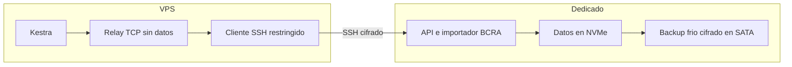

# BCRA: migracion del importador al dedicado

## Contrato

Se traslada exclusivamente `bcra-file-api-poc` y su volumen completo desde la VPS
al dedicado `dedicated_prod_01`. Kestra conserva sus flows, historial y scheduler
en la VPS. Las consultas comerciales identificadas siguen usando la API oficial
del BCRA; el servicio de archivos tiene dos integraciones Kestra: actualizacion
nocturna y consulta diagnostica.

La base Ansible procede del PR #683, integrado a `main`. Esta ampliacion tiene playbooks propios y
no vuelve a provisionar el host completo ni aplica cambios de seguridad ajenos
al servicio. Todas las aplicaciones, claves y datos se administran por roles;
las credenciales se suministran mediante archivos privados del controlador, nunca
mediante argumentos con secretos ni inventarios versionados.

## Topologia

- El dedicado ejecuta la misma imagen OCI por digest y conserva sus datos en
  `/srv/redunisol/state/bcra-file-api`, sobre el NVMe existente.
- Su API escucha exclusivamente en `127.0.0.1:18082`.
- La VPS mantiene un enlace SSH persistente hacia una cuenta restringida del
  dedicado. La clave privada permanece en la VPS. La cuenta permite solamente
  el forwarding local hacia la API, sin shell, PTY, agente ni otros destinos.
- Un puente TCP liviano en `kestra_net` conserva el alias
  `bcra-file-api-poc:8080` y el acceso local original. No monta el volumen BCRA
  ni ejecuta el importador. No se modifica la URL ni el token de Kestra, ni se
  reinicia el runtime compartido para este corte.

Los namespaces Docker son locales a cada host; no se supone que `kestra_net`
conecte las dos maquinas. No se publica un dominio o puerto nuevo de la API.

## Datos y corte

1. Verificar identidad de ambos hosts, imagen y volumen; mantener el importador
   de origen detenido y el destino sin arrancar.
2. Preparar receptor de copia acotado a la carpeta de datos, con clave temporal
   restringida por origen y `rrsync -wo`. La privada no sale de la VPS.
3. Copiar con rsync conservando hardlinks, UID/GID numericos, permisos y journals,
   con ancho de banda limitado. No usar borrado implicito ni copiar solo las
   publicaciones activas. Conservar tambien `pending/` y los comprimidos.
4. Comparar inventarios y SHA-256 antes del primer arranque. Verificar SQLite en
   el dedicado; recuperar journals pendientes con apertura normal, sin
   `immutable=1` sobre componentes incompletos. No renovar fechas de vigencia.
5. Revocar la llave temporal de recepcion, desmontar su alias validado y quitar
   solamente la privada correspondiente en la VPS. Conservar los reportes.
6. Derivar el recibo de migracion desde la evidencia real de copia, SQLite y
   revocacion, sin flags de exito manuales. Guardar sus hashes, imagen y corte.
7. Crear el backup frio completo en el repositorio Restic cifrado existente del
   SATA, con tags y evidencia propios. Comprobar los datos del repositorio y
   restaurar un manifest a una carpeta aislada para comparar su SHA-256. Esto
   no acredita una restauracion integral del dataset ni un backup continuo.
8. Arrancar el destino, verificar estado autenticado y rechazo sin token, y
   preparar el enlace privado. Mantener el importador original detenido.
9. Comprobar desde la red real de Kestra antes de admitir un nuevo refresh. No
   ejecutar dos importadores ni reutilizar el job interrumpido como si siguiera
   activo. Una ejecucion nueva permite continuar checkpoints compatibles.

El rol impide el arranque sin los recibos de migracion y backup frio, con los
checksums esperados. La copia usa un alias bind temporal para que el receptor
sin privilegios alcance exclusivamente el volumen BCRA; los permisos de los
directorios de estado del host se conservan.

El primer arranque cambia legitimamente `refresh.json` de running a interrupted;
por eso los hashes se comparan antes. Las capacidades del destino deben coincidir
con el origen: un historico incompleto no se declara listo por migrarlo.

## Verificacion y recuperacion

Separar apply de verify, registrar revision Git, imagen efectiva, fingerprints,
versiones y resultados sin secretos. Repetir el apply para comprobar convergencia.
Las pruebas sinteticas no sustituyen la comparacion de datos reales ni la
conectividad desde Kestra. La vigilancia de salud del host y el respaldo de su
configuracion no acreditan por si solos un backup consistente de las bases BCRA.

Para volver a la VPS: detener primero el destino y comprobarlo, retirar el puente
y el enlace, y arrancar la imagen original con el volumen conservado. No copiar
automaticamente escrituras nuevas sobre el respaldo. Si se admitieron nuevas
actualizaciones, revisar versiones y antiguedad antes del rollback; la vigencia
de 72 horas sigue aplicando.

La copia de origen se conserva detenida como punto de vuelta hasta una retirada
explicita. El destino externo de backups de BCRA y su restauracion se verifican
por separado; una copia en el mismo dedicado no cubre su perdida completa.

## Ruta de despliegue

Los playbooks `bcra-file-api-deploy.yml` y `bcra-file-api-verify.yml` son la ruta
operativa del servicio. Los playbooks `bcra-data-*`, `bcra-backup-cold.yml` y
`bcra-private-link.yml` separan transferencia, integridad, respaldo y transporte.
Los defaults no autorizan escrituras; cada apply recibe la revision Git exacta
y la autorizacion correspondiente. CI valida codigo sin contactar los hosts.

El workflow manual legacy `deploy-bcra-file-poc.yml` se retira para impedir que
un despliegue habitual vuelva a levantar el importador en la VPS. El publisher
de imagenes sigue disponible; publicar otro tag no cambia el digest aplicado.
El Compose y env cifrado historicos se conservan para pruebas y rollback
explicito, no como destino productivo de los siguientes despliegues.
