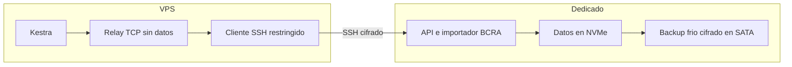

# BCRA: migracion del importador al dedicado

## Contrato

Se traslada exclusivamente `bcra-file-api-poc` y su volumen completo desde la VPS
al dedicado `dedicated_prod_01`. Kestra conserva sus flows, historial y scheduler
en la VPS. Las consultas comerciales identificadas siguen usando la API oficial
del BCRA; el servicio de archivos tiene dos integraciones Kestra: actualizacion
nocturna y consulta diagnostica.

La base Ansible procede del [PR #683](https://github.com/Red-Unisol/redunisol-platform/pull/683),
integrado a `main`. La migracion del servicio se incorporo con el
[PR #711](https://github.com/Red-Unisol/redunisol-platform/pull/711); el estado
integrado resultante es `474ae4a06f8bd658d204f5826a74c634afffbfee`.
Esta ampliacion tiene playbooks propios y
no vuelve a provisionar el host completo ni aplica cambios de seguridad ajenos
al servicio. Todas las aplicaciones, claves y datos se administran por roles;
las credenciales se suministran mediante archivos privados del controlador, nunca
mediante argumentos con secretos ni inventarios versionados.

## Topologia

- El dedicado ejecuta la misma imagen OCI por digest y conserva sus datos en
  `/srv/redunisol/state/bcra-file-api`, sobre el NVMe existente.
  La imagen fijada es
  `ghcr.io/red-unisol/bcra-file-api@sha256:78d3b2536caf2c9a281804b9a5fe21aa5e030c8240cad75a88a7d339481af6e4`.
- Su API escucha exclusivamente en `127.0.0.1:18082`.
- La VPS mantiene un enlace SSH persistente hacia una cuenta restringida del
  dedicado. La clave privada permanece en la VPS. La cuenta permite solamente
  el forwarding local hacia la API, sin shell, PTY, agente ni otros destinos.
- Un puente TCP liviano en `kestra_net` conserva el alias
  `bcra-file-api-poc:8080` y el acceso local original. No monta el volumen BCRA
  ni ejecuta el importador. No se modifica la URL ni el token de Kestra, ni se
  reinicia el runtime compartido para este corte.

Los namespaces Docker son locales a cada host; no se supone que `kestra_net`
conecte las dos maquinas. No se publica un dominio o puerto nuevo de la API.

## Datos y corte

1. Verificar identidad de ambos hosts, imagen y volumen; mantener el importador
   de origen detenido y el destino sin arrancar.
2. Preparar receptor de copia acotado a la carpeta de datos, con clave temporal
   restringida por origen y `rrsync -wo`. La privada no sale de la VPS.
3. Copiar con rsync conservando hardlinks, UID/GID numericos, permisos y journals,
   con ancho de banda limitado. No usar borrado implicito ni copiar solo las
   publicaciones activas. Conservar tambien `pending/` y los comprimidos.
4. Comparar inventarios y SHA-256 antes del primer arranque. Verificar SQLite en
   el dedicado; recuperar journals pendientes con apertura normal, sin
   `immutable=1` sobre componentes incompletos. No renovar fechas de vigencia.
5. Revocar la llave temporal de recepcion, desmontar su alias validado y quitar
   solamente la privada correspondiente en la VPS. Conservar los reportes.
6. Derivar el recibo de migracion desde la evidencia real de copia, SQLite y
   revocacion, sin flags de exito manuales. Guardar sus hashes, imagen y corte.
7. Crear el backup frio completo en el repositorio Restic cifrado existente del
   SATA, con tags y evidencia propios. Ejecutar `restic check --read-data` sobre
   el repositorio completo, dentro del mismo lock y presupuesto temporal, y
   restaurar un manifest a una carpeta aislada para comparar su SHA-256. Esto
   no acredita una restauracion integral del dataset ni un backup continuo.
8. Arrancar el destino, verificar estado autenticado y rechazo sin token, y
   preparar el enlace privado. Mantener el importador original detenido.
9. Comprobar desde la red real de Kestra antes de admitir un nuevo refresh. No
   ejecutar dos importadores ni reutilizar el job interrumpido como si siguiera
   activo. Una ejecucion nueva permite continuar checkpoints compatibles.

El rol impide el arranque sin los recibos de migracion y backup frio, con los
checksums esperados. La copia usa un alias bind temporal para que el receptor
sin privilegios alcance exclusivamente el volumen BCRA; los permisos de los
directorios de estado del host se conservan.

El primer arranque cambia legitimamente un `refresh.json` con estado `running`
a `failed`, con la marca de interrupcion por reinicio; no reanuda el trabajo al
arrancar. Por eso los hashes se comparan antes. Las capacidades del destino deben coincidir
con el origen: un historico incompleto no se declara listo por migrarlo.

## Verificacion y recuperacion

Separar apply de verify, registrar revision Git, imagen efectiva, fingerprints,
versiones y resultados sin secretos. Repetir el apply para comprobar convergencia.
Las pruebas sinteticas no sustituyen la comparacion de datos reales ni la
conectividad desde Kestra. La vigilancia de salud del host y el respaldo de su
configuracion no acreditan por si solos un backup consistente de las bases BCRA.

Para volver a la VPS: detener primero el destino y comprobarlo, retirar el puente
y el enlace, y arrancar la imagen original con el volumen conservado. No copiar
automaticamente escrituras nuevas sobre el respaldo. Si se admitieron nuevas
actualizaciones, revisar versiones y antiguedad antes del rollback; la vigencia
de 72 horas sigue aplicando.

La copia de origen se conserva detenida como punto de vuelta hasta una retirada
explicita. El destino externo de backups de BCRA y su restauracion se verifican
por separado; una copia en el mismo dedicado no cubre su perdida completa.

## Ruta de despliegue

Los playbooks `bcra-file-api-deploy.yml` y `bcra-file-api-verify.yml` son la ruta
operativa del servicio. Los playbooks `bcra-data-*`, `bcra-backup-cold.yml` y
`bcra-private-link.yml` separan transferencia, integridad, respaldo y transporte.
Los defaults no autorizan escrituras; cada apply recibe la revision Git exacta
y la autorizacion correspondiente. CI valida codigo sin contactar los hosts.

El workflow manual legacy `deploy-bcra-file-poc.yml` se retira para impedir que
un despliegue habitual vuelva a levantar el importador en la VPS. El publisher
de imagenes sigue disponible; publicar otro tag no cambia el digest aplicado.
El Compose y env cifrado historicos se conservan para pruebas y rollback
explicito, no como destino productivo de los siguientes despliegues.

## Revision final del corte

Esta seccion registra las decisiones confirmadas. Los resultados del corte se
documentan con los recibos y verificaciones reales del operador; integrar codigo
en `main` no acredita haber ejecutado el corte.

Decisiones confirmadas:

- PR #683 y PR #711 integrados; base Git de esta operacion
  `474ae4a06f8bd658d204f5826a74c634afffbfee`. Las correcciones finales conservan
  su propia revision aplicada, que se registra por separado.
- Se conserva el digest de imagen anterior. No se cambia la logica de importacion,
  los contratos de consulta ni la fuente BCRA de las evaluaciones comerciales.
- Solo se aplica el servicio BCRA, su transferencia, backup inicial y transporte
  privado. No se ejecuta el provisionamiento general de foundation ni los roles
  de seguridad o mantenimiento del host como parte de este corte.
- Kestra conserva flows, scheduler, token y URL. Su red real accede mediante el
  puente y el enlace SSH restringido; no se publica una API BCRA nueva.
- El contenedor y volumen originales permanecen detenidos y conservados. No se
  borran datos de origen ni se habilitan dos importadores en paralelo.

Los recibos del servicio se conservan fuera del bind de datos, bajo
`/srv/redunisol/platform/bcra-file-api`, con propietario root y modo `0600`.
`post-recovery-manifest.json` acredita el arbol final tras SQLite; no debe
confundirse con el arbol anterior de la copia. La evidencia estable del runtime
se registra en `/var/lib/redunisol-foundation/evidence/bcra-file-api.json`.
No se copian secretos ni filas de las bases a este documento.

La activacion de inventario se promueve el 12/11/2026 despues de verificar
17.521.923.276 bytes unicos copiados y recuperar SQLite exclusivamente en el
destino. La publicacion vigente conserva 42.316.211 filas y su `checked_at`;
el padron historico pendiente conserva el checkpoint de 26.300.000 filas de
entrada, sin declarar listo el historico. El recibo consolidado de migracion
y el recibo de backup frio quedan fijados por SHA-256 en el inventario.

El backup inicial es el snapshot Restic
`ff8c21758a7e63d18b1309a2243907eaf74bad162478428981a636cb61c8be36`.
El repositorio completo paso `check --read-data` el 12/11/2026 a las
04:39:26 UTC. La restauracion aislada del manifest coincide con el SHA del
recibo de migracion. Estos resultados habilitan el deploy; su apply y las
pruebas reales de conectividad se registran por separado.

## Checkpoint operativo del 12/11/2026 (ART)

Las horas siguientes son capturas del corte, expresadas en ART (UTC-3), con
su referencia UTC. Acreditan lo observado en ese momento y no garantizan el
estado actual del servicio ni la finalizacion posterior de una importacion.

El [PR #712](https://github.com/Red-Unisol/redunisol-platform/pull/712) quedo
integrado en `main` como `4dc10f98f3271976a2ec1e0ee4b50986f37d4541`.
La API quedo activa a las 01:45:19 ART (04:45:19 UTC); su label de revision
aplicada confirma ese SHA. El estado autenticado mostro `ready=true`,
42.316.211 filas y periodo `202609` (septiembre), con la misma version del
origen. `history_ready=false` conserva la limitacion previa al corte. La
segunda aplicacion termino con `ok=40, changed=0`; el verify de solo lectura,
con `ok=19, changed=0`.

El [PR #713](https://github.com/Red-Unisol/redunisol-platform/pull/713) quedo
integrado como `79edba8eac71fae6e5fba55d7dc0262345acad1c`. Corrige la
verificacion de `RestrictAddressFamilies` en systemd 239: ante la salida
`[unprintable]` consulta D-Bus, exige la firma `(bas)`, el modo de lista de
permitidos (`true`) y las familias exactas `AF_UNIX`, `AF_INET` y `AF_INET6`.
Sus 28 tests pasaron. Esta revision
se aplico al cliente privado; la API conserva su revision `4dc10f98` y no
requiere redeploy por el cambio del verificador del enlace.

El cliente privado quedo operativo a las 01:50:31 ART (04:50:31 UTC). La
primera unidad se habia escrito con `4dc10f98`; completar la aplicacion con
`79edba8e` creo el proxy sin reiniciar el tunel. La repeticion dio
`ok=3, changed=0`; los verifies de ambos hosts dieron `changed=0`. Desde la
red efectiva de Kestra, `GET /status` devolvio 200 con su token existente y
el alias resolvio solamente al proxy `172.18.0.6`. El importador de origen
siguio detenido. Kestra conservo el mismo contenedor y fecha de arranque,
sin reinicio durante el corte.

Se admitio una actualizacion real a las 01:51:33 ART (04:51:33 UTC): ejecucion
Kestra `E5FNkLr9UUBr9FlmD9PtV`, job BCRA
`fcdd2c76a9cd44faa9c1a2d59bacc3e9`, con `request_id` coincidente con la
ejecucion. La captura de las 01:56 ART (04:56 UTC) mostro fase
`download_PADRON`, estado `running` y sin error. Esa observacion no acredita
la finalizacion del refresh ni declara listo el historico.
La captura de las 01:59:41 ART confirmo fase `padron`, 30.393.719 filas y
ausencia de error: el importador ya habia superado el checkpoint conservado.
El estado Kestra `PAUSED` entre consultas corresponde al `LoopUntil` de un
minuto; el trabajo remoto sigue ejecutandose y no es una pausa manual.

La clave temporal de copia del origen y la autorizacion/alias de recepcion
del destino habian sido revocados. A las 01:55:59 ART (04:55:59 UTC) se
retiraron el archivo privado `0600` y el directorio temporal vacio del
controlador.

La muestra de la VPS de origen a las 01:50 ART (04:50 UTC), con BCRA ya
detenido, registro 31,4 % de iowait. El sitio publico respondio
200 `DYNAMIC` en 2,235 s y el origen respondio 200 en 0,961 s. Son resultados
puntuales; el corte no demuestra haber resuelto toda la carga de I/O ni la
estabilidad futura del sitio.
Un muestreo independiente de 2,53 s a las 02:03:35 ART confirmo el contenedor
BCRA detenido y sin procesos, iowait de 39,76 % y `sda` cerca de 100 % busy
con solo 0,36 MiB/s de escritura y aproximadamente 119 ms de espera media.
El mayor escritor visible fue PostgreSQL de Kestra, con 0,08 MiB/s; no se
atribuye a ese proceso la causa del problema. El siguiente diagnostico debe
correlacionar la latencia/flush del bloque de la VPS con sus escrituras y WAL,
sin asumir que hay otro importador masivo ni modificar servicios por esta
medicion breve.

## Alcance comprobable del respaldo

El respaldo BCRA de este corte es una copia fria inicial, cifrada y local en el
SATA del mismo dedicado. Antes de emitir su recibo se verifica el repositorio
completo mediante `check --read-data`; `repository_integrity_verified`,
`read_data` y su fecha UTC pertenecen a ese chequeo real. Reaplicar con un recibo
inicial valido conserva su fecha original: no renueva la prueba de integridad.

La prueba de restauracion recupera solo un manifest a una carpeta aislada y
compara su SHA. No acredita restaurar todas las bases BCRA ni una recuperacion
integral de la aplicacion. La comprobacion cifrada del repositorio y la prueba
de restauracion tienen alcances distintos y quedan registradas por separado.

Este corte no configura un backup continuo ni una copia externa de BCRA. Los
timers y comprobaciones existentes de foundation mantienen su propio alcance y
evidencia de configuracion del host; no se presentan como respaldo periodico de
las bases BCRA. Compartir el repositorio agrega sus bloques al chequeo global,
sin cambiar las etiquetas, recibos o metricas de foundation ni aplicar retencion
o poda. Una copia recuperable fuera del dedicado y una restauracion completa de
BCRA requieren verificaciones propias posteriores.
